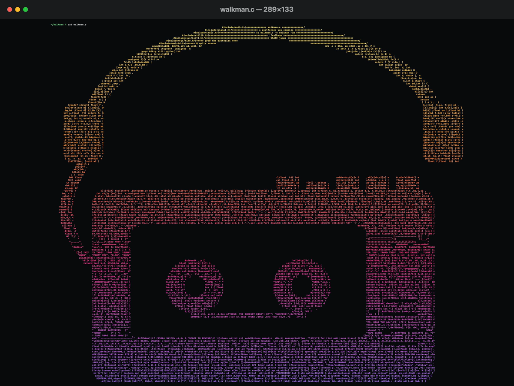
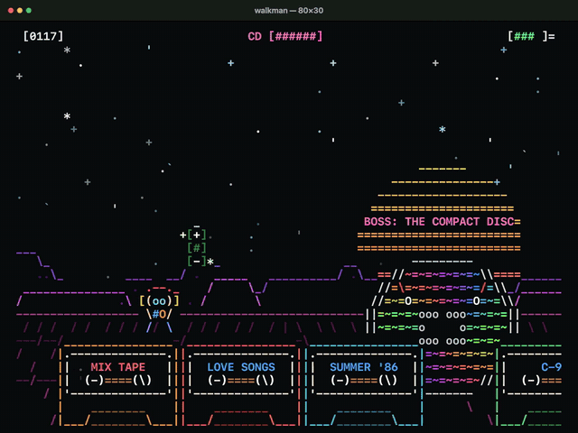

# walkman.c

A platformer for your terminal, written as one C file shaped like a Walkman wearing its headphones 📼

> **Alpha.** One kind of level, one boss, and plenty still to tune. Bug reports and ideas are welcome in the issues.

<p align="center"></p>

<p align="center"></p>

## Run it

```sh
cc walkman.c -o walkman -lm && ./walkman
```

The same line works on macOS and Linux. Use a terminal with 24-bit color, at least 64x24; a bigger window shows more of the world.

**SPACE** jumps (so do ↑, W, K and Enter). **Q** quits.

The music is synthesized when the game starts, written to `/tmp/walkman-*.wav` and played with `afplay` on macOS or `aplay` on Linux (from alsa-utils). Without either one, it plays silently.

## The game

You run on Walkman batteries across a skyline of cassettes. The batteries last 7 seconds, so grab the AA cells floating over the tapes. When they die, the tape drags to a stop: the music sags and the whole world slows down with it.

The sky is a red storm: clouds roll over a burning sun, lightning strikes every few seconds, and ash drifts up past the mountains.

Every so often the sun goes dark and **the Compact Disc** rises in its place: the format that killed the cassette. It throws six discs at your feet, each with a battery hanging over it. Jump the discs, keep your batteries up, and the CD gets **SKIPPED!** Touch one and you're **SCRATCHED**.

The level is endless and generated as you run. Every jump in it is possible: a bot checks that (see below).

## How it's made

[`walkman.readable.c`](walkman.readable.c) is the same game with real names and comments. It draws exactly the same frames.

`walkman.c` is generated from it in two steps:

- [`minify.py`](minify.py) strips the comments and the `DEV` parts (with `unifdef`), drops `static` and `const`, merges adjacent strings and gives every name a short one. It writes [`walkman.min.c`](walkman.min.c).
- [`shape.py`](shape.py) packs that into the Walkman. The `#include` lines form the top of the headband, each padded with a comment that carries the build notes. Every other token is laid row by row into the headband, the ear cups, the cable and the player: around the cassette window with its two reels, and up into the buttons, with PLAY pressed down. Each row is justified so the outline stays crisp, and long strings are split across the gaps.

```sh
python3 minify.py && python3 shape.py    # rewrites walkman.min.c and walkman.c
```

## The bot

[`dev.h`](dev.h) is only compiled into the readable version with `-DDEV`. It adds a bot that plays the game by searching two jumps ahead:

```sh
cc -DDEV walkman.readable.c -o walkman-dev -lm
./walkman-dev --bot              # watch it play
./walkman-dev --test 5400 20     # 20 levels, 90 seconds each, no screen
```

The test is how the level generator stays fair: if the bot can't survive a level, a person can't either.

More C in a shape: [pumpkin.c](https://github.com/maximbilan/pumpkin-c), a spinning 3D jack-o'-lantern.

## License

[MIT](LICENSE)
